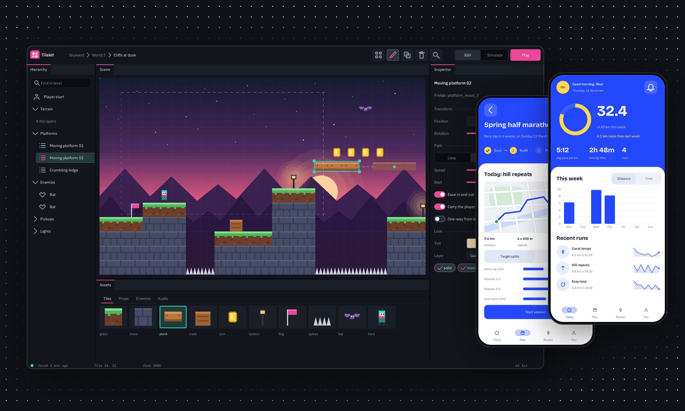
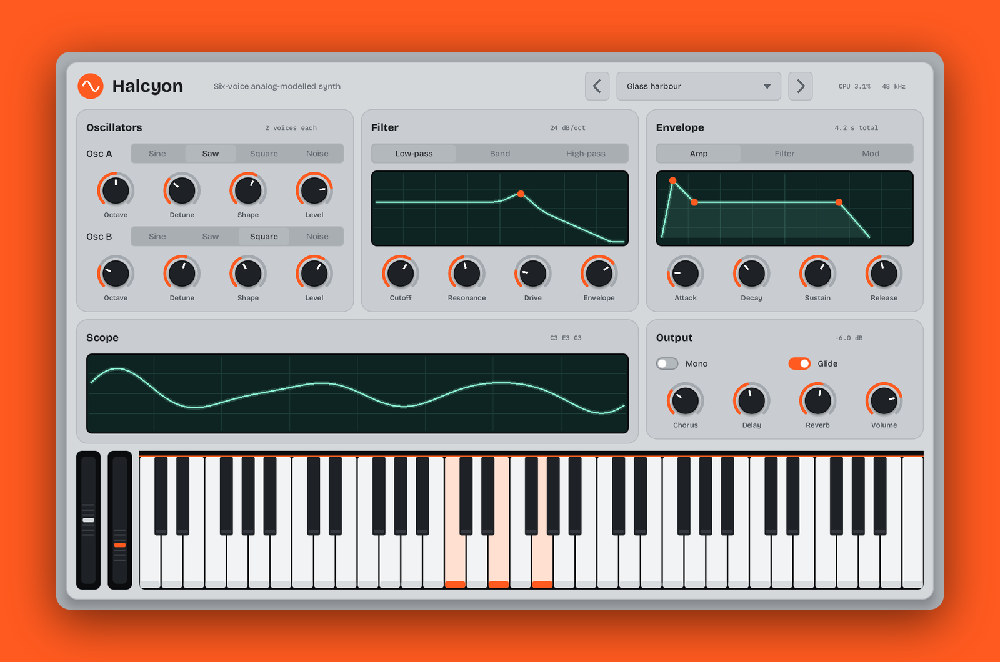
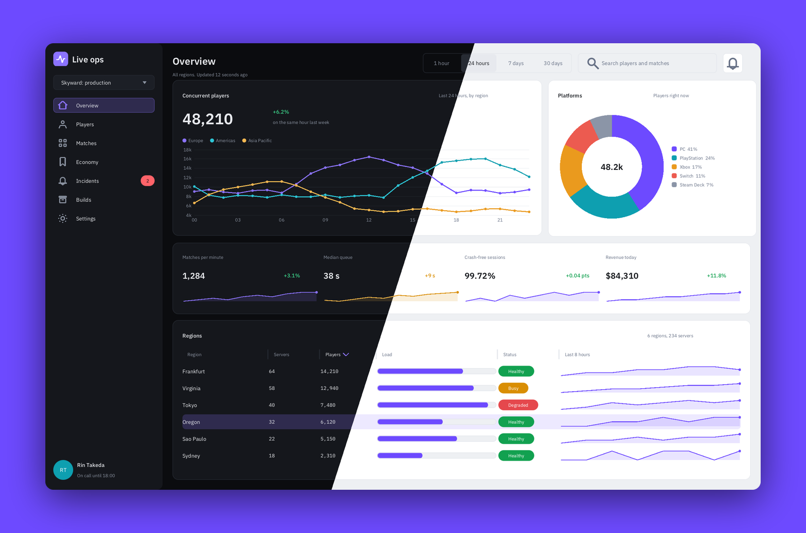
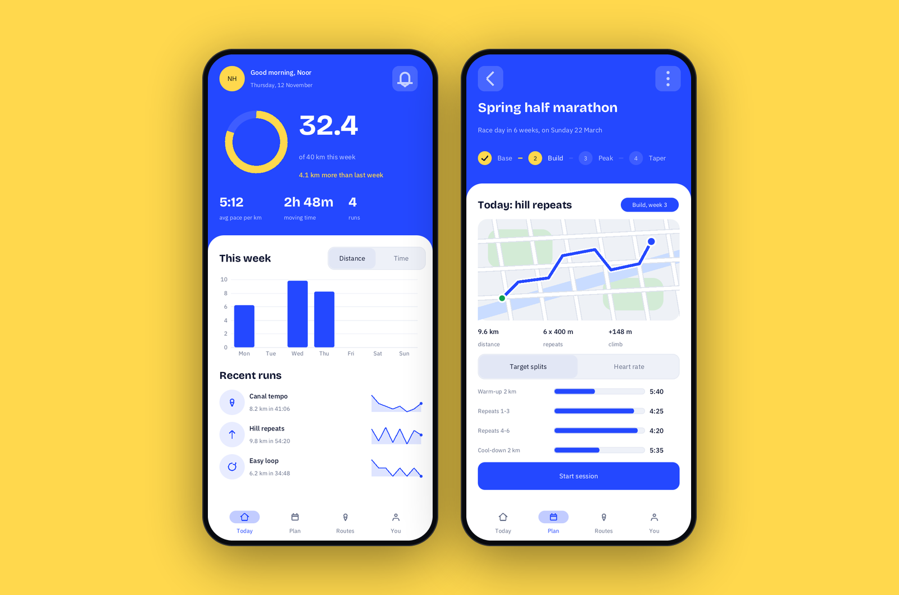
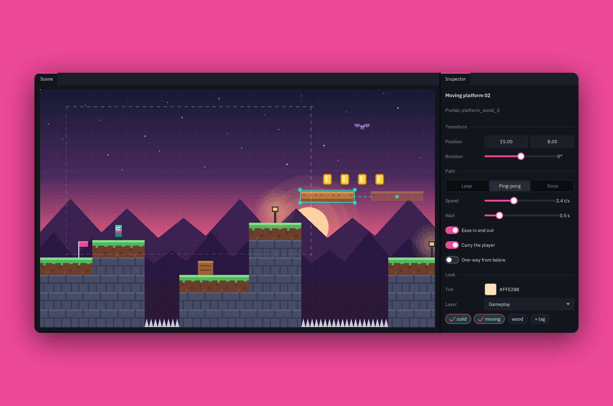

<p align="center">
  
</p>

<p align="center">
  <b>A fast, good-looking immediate-mode UI library for C++17.</b><br>
  Desktop, phone, browser and game engine, all from one small library with no dependencies.
</p>

<p align="center">
  <a href="https://github.com/WavestormSoftware/Radon/actions/workflows/ci.yml"></a>
  <a href="LICENSE"></a>
  
  
</p>



Immediate-mode UI is the quickest way to build tools: you write a function that draws the interface every
frame, and there's no widget tree to keep in sync with your data. The trade-off has usually been that it
looks like a debug overlay. Radon gives you the same quick workflow with a UI you can put in front of
users: smooth rounded shapes, animated transitions, a real theme system, touch gestures, and
accessibility.

```cpp
if (rd::begin_window(ui, "Settings", rect)) {
    rd::slider(ui, "Volume", volume, 0.0f, 1.0f);
    rd::toggle(ui, "Dark mode", dark);
    if (rd::button(ui, "Save", rd::ButtonStyle::Primary).clicked) save();
    rd::end_window(ui);
}
```

That's the whole model. Your variables are the state, and widgets return what happened this frame.

## Why Radon

|  |  |
|---|---|
| **Fast and predictable** | Every pool is allocated once at startup, and a test checks that frames make **zero heap allocations**. The full widget gallery takes about 0.3 ms of CPU per frame. When nothing moves, the app sleeps instead of redrawing. |
| **Looks good by default** | Rounded shapes, borders and shadows are drawn by the GPU. Popups, tabs, switches and page changes animate, and one flag turns all motion off. Light and dark themes follow the system setting. |
| **Built for touch too** | `Theme::touch()` gives finger-sized controls. You also get flick scrolling, pinch and swipe, pull to refresh, swipeable rows, bottom sheets, safe areas, soft-keyboard handling and haptics. |
| **90+ widgets** | Everything from buttons to a docking system: sortable tables with 100,000 rows, charts, rich text and Markdown, date, time and color pickers, knobs, wizards, drag and drop, toasts, and 56 vector icons. |
| **Runs anywhere** | Windows, Linux, macOS, Web (WebGL 2), Android and iOS through one SDL3 + OpenGL ES 3 backend. The core includes no platform headers, so a backend for your own engine is a few hundred lines. |
| **Made for games** | Show your game or 3D view in a panel, draw sprites with `rd::Canvas`, read gamepads, play sounds, or drive Radon from any engine through the C API. A raylib backend is included. |
| **Accessible** | It builds an accessibility tree with roles, labels, values and actions. You can operate everything from the keyboard or a gamepad, and fallback fonts bring in emoji, CJK and symbols. |

## Built with Radon

Every picture on this page is a real Radon app, not a mock-up: four small products in
[`examples/showcase`](examples/showcase), each with its own theme and typefaces.

| | |
|---|---|
|  |  |
| **Halcyon**, a synthesizer plugin: knobs, segmented controls, and scope, filter and envelope screens drawn with `rd::Canvas`. | **Live ops**, a game-server dashboard: line and donut charts, sparklines and a sortable table. The same code is shown in dark and light. |
|  |  |
| **Stride**, a running app for phones: touch metrics, a progress ring, a bar chart, a training plan with `steps`, and a bottom navigation bar. | **Tilekit**, a level editor: docking panels, a tile-map scene drawn with `rd::Canvas`, a tree and an inspector. |

Run them with `radon_showcase --page 0..4` (Stride looks best at `--size 390x844`). The widget-by-widget
[gallery](docs/widgets.md) and eleven [small examples](docs/examples.md) cover the rest.

## Quick start

```cpp
#include <radon/radon.hpp>

rd::Context ui;                                  // allocates every pool once
// ui.load_font(ttf_bytes, ttf_size, 16);        // fonts come from memory

void frame(const rd::Input& input, float dt) {
    ui.begin_frame(input, dt);
    static rd::Rect win{20, 20, 320, 200};
    if (rd::begin_window(ui, "Settings", win)) {
        static bool sound = true;
        static float volume = 0.5f;
        const float cols[] = {90, -1};           // 90 px label column, then fill
        rd::layout_row(ui, 2, cols, 2, 0);
        rd::label(ui, "Volume");
        rd::slider(ui, "##volume", volume, 0.0f, 1.0f);
        rd::layout_row(ui, 1, nullptr, 0, 0);
        rd::checkbox(ui, "Sound", sound);
        if (rd::button(ui, "Apply", rd::ButtonStyle::Primary).clicked) rd::toast(ui, "Applied");
        rd::end_window(ui);
    }
    ui.end_frame();
    // render ui.draw_list(): see backends/sdl3_gl, or docs/backends.md to write your own
}
```

[Getting started](docs/getting-started.md) walks through a complete app, including the window, input and
rendering.

## Use it in your project

```cmake
include(FetchContent)
FetchContent_Declare(radon GIT_REPOSITORY https://github.com/WavestormSoftware/Radon.git GIT_TAG main)
set(RD_BACKEND_SDL3_GL ON)   # optional: also fetch SDL3 and build the backend; leave off for the core alone
FetchContent_MakeAvailable(radon)
target_link_libraries(app PRIVATE radon::radon radon::sdl3_gl)   # core + the SDL3/OpenGL backend
```

You can also install the core on its own and find it with `find_package(Radon)`; see
[building](docs/building.md).

## Try the demos

```sh
cmake --preset linux-clang-release            # or linux-gcc-debug, macos-release, windows-msvc-release
cmake --build --preset linux-clang-release
./build/linux-clang-release/examples/desktop_demo/radon_desktop_demo      # the gallery
./build/linux-clang-release/examples/radon_ex_11_mobile_app                # a phone-style app
```

The demos use a system font, or one you choose: put it at `examples/assets/font.ttf`, or pass
`--font <path>` or `RD_FONT=<path>`. Useful flags: `--page 0..12`, `--light` / `--dark`, `--touch`,
`--size 400x800` and `--screenshot out.png`.

## Documentation

| | |
|---|---|
| [Getting started](docs/getting-started.md) | Embed Radon in your app, step by step |
| [Widget guide](docs/widgets.md) | Every widget with code and pictures |
| [Layout](docs/layout.md) | Rows, columns, regions, indentation |
| [Theming](docs/theming.md) | Colors, metrics, presets, touch metrics, scoped overrides |
| [Game integration](docs/game-integration.md) | Show an engine view in a panel; Radon inside an engine |
| [Platforms](docs/platforms.md) | Mobile sizing, touch, and native features per platform |
| [Examples](docs/examples.md) | Eleven small apps and the gallery |
| [API reference](docs/usage.md) | Every public function |
| [Backends](docs/backends.md) | Using the SDL3 backend or writing your own renderer |
| [Building](docs/building.md) | Linux, Windows, macOS, Web, Android, iOS |
| [Status](docs/STATUS.md) | What has been built and tested on which platform |

## Status

Radon is young (0.3), and the API can still change between minor versions. Linux is the main development
platform. CI builds and tests Windows, macOS, Web, Android and iOS, but most of what runs only on a
device (touch, haptics, the soft keyboard) has been tested only in unit tests so far.
[docs/STATUS.md](docs/STATUS.md) lists exactly what has been verified on each platform. Bug reports from
real devices are very welcome.

## Contributing

Issues and pull requests are welcome. [CONTRIBUTING.md](CONTRIBUTING.md) is short, so please read it
first. Report security problems privately as described in [SECURITY.md](SECURITY.md).

## License

MIT. See [LICENSE](LICENSE). Vendored code (stb_truetype, stb_rect_pack, doctest) and the SDL3 backend
dependency are listed in [THIRD_PARTY_NOTICES.md](THIRD_PARTY_NOTICES.md).
