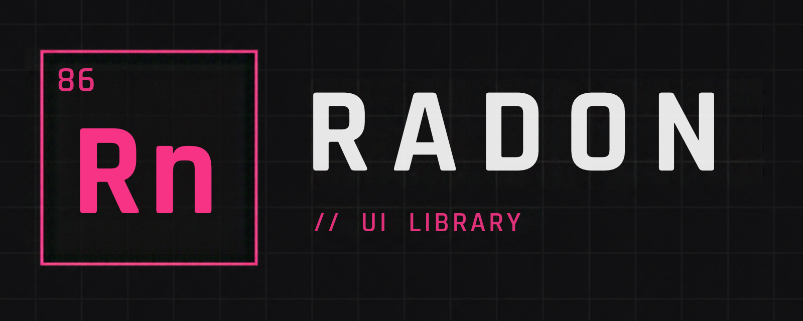
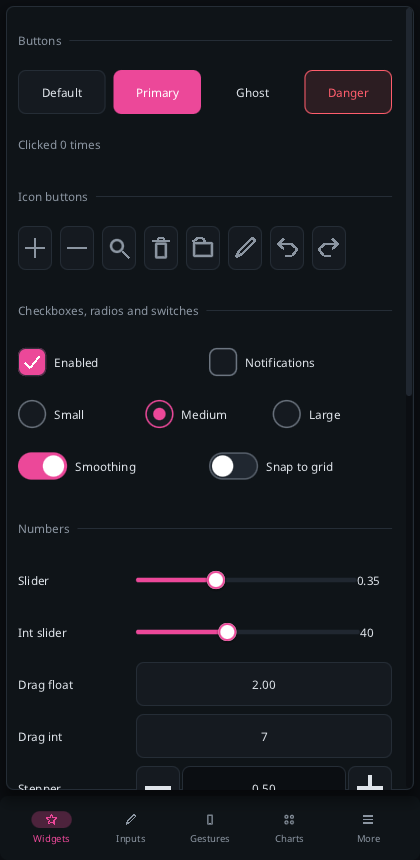

<p align="center">
  
</p>

[](https://github.com/WavestormSoftware/Radon/actions/workflows/ci.yml)
[](LICENSE)

A small, fast, immediate-mode UI library for C++17. Call widgets every frame, get results back, and
render the draw list it produces with any renderer. No retained widget tree, no heap allocation per frame,
no dependencies in the core.


| Desktop | Phone |
|---|---|
|  |  |

- **70+ widgets**: buttons, checkbox, radio, switch, sliders, range slider, steppers, text boxes with
  selection and clipboard, password and search fields, multi-line text area, combo, segmented control,
  chips, rating, tabs, list box, sortable tables, a clipper for 100,000-row lists, tree, calendar and date
  picker, pagination, breadcrumbs, menu bar, context menus, popups, modal dialogs, drawers and bottom
  sheets, toasts, alerts, cards, avatars, color picker, plots, progress ring, skeletons, 42 vector icons.
- **Transitions**: popups, dialogs, drawers, toasts and tooltips animate in; tabs, switches and segmented
  controls slide; `transition_begin` fades page changes; `animate()` drives your own. One flag turns all
  motion off.
- **Made for touch as well as mouse**: `Theme::touch()` gives finger-sized targets, flick scrolling has
  momentum, a long-press is a right-click, and layouts respect the safe area. UI is laid out in logical
  pixels, so it has the same physical size on a 4K monitor and a phone.
- **Native where it counts**: system light/dark theme, mouse cursors, IME and soft keyboard placement,
  file dialogs, opening URLs, the Android back button, app background/foreground, and sleeping while
  idle instead of redrawing. See [platforms](docs/platforms.md).
- **Portable**: Windows, Linux, macOS, Web (WebGL2), Android and iOS through one SDL3 + OpenGL ES 3
  backend. The core includes no platform headers; write your own backend in a few hundred lines.
- **Predictable**: all memory is allocated up front from a `Config`. A full pool never crashes: the work
  is skipped and `ctx.error()` turns true. An allocation test checks zero heap allocations per frame.

Radon is young (0.2). Only Linux has been built and run so far; [docs/STATUS.md](docs/STATUS.md) lists what
has been verified on each platform.

## Quick start

```cpp
#include <radon/radon.hpp>

rd::Context ui;                                  // allocates every pool once
// ui.load_font(ttf_bytes, ttf_size, 16);        // fonts come from memory

void frame(const rd::Input& input, float dt) {
    ui.begin_frame(input, dt);
    static rd::Rect win{20, 20, 320, 200};
    if (rd::begin_window(ui, "Settings", win)) {
        static bool sound = true;
        static float volume = 0.5f;
        const float cols[] = {90, -1};           // 90 px label column, then fill
        rd::layout_row(ui, 2, cols, 2, 0);
        rd::label(ui, "Volume");
        rd::slider(ui, "##volume", volume, 0.0f, 1.0f);
        rd::layout_row(ui, 1, nullptr, 0, 0);
        rd::checkbox(ui, "Sound", sound);
        if (rd::button(ui, "Apply", rd::ButtonStyle::Primary).clicked) rd::toast(ui, "Applied");
        rd::end_window(ui);
    }
    ui.end_frame();
    // render ui.draw_list(): see backends/sdl3_gl, or docs/backends.md to write your own
}
```

## Use it in your project

```cmake
include(FetchContent)
FetchContent_Declare(radon GIT_REPOSITORY https://github.com/WavestormSoftware/Radon.git GIT_TAG main)
set(RD_BACKEND_SDL3_GL ON)   # optional: also fetch SDL3 and build the backend; leave off for the core alone
FetchContent_MakeAvailable(radon)
target_link_libraries(app PRIVATE radon::radon radon::sdl3_gl)   # core + the SDL3/OpenGL backend
```

The core alone can also be installed and found with `find_package(Radon)`; see
[building](docs/building.md).

## Try it

```sh
cmake --preset linux-clang-release            # or linux-gcc-debug, macos-release, windows-msvc-release
cmake --build --preset linux-clang-release
./build/linux-clang-release/examples/desktop_demo/radon_desktop_demo      # the gallery
./build/linux-clang-release/examples/radon_ex_11_mobile_app                # a phone-style example
```

The demos pick a system font, or yours: `examples/assets/font.ttf`, `--font <path>` or `RD_FONT=<path>`.
Useful flags: `--page 0..7`, `--light` / `--dark`, `--touch`, `--size 400x800`, `--screenshot out.png`.

## Documentation

| | |
|---|---|
| [Getting started](docs/getting-started.md) | Embed Radon in your app, step by step |
| [Game integration](docs/game-integration.md) | Show an engine view in a panel; Radon inside an engine |
| [Widget guide](docs/widgets.md) | Every widget with code and pictures |
| [Layout](docs/layout.md) | Rows, columns, regions, indentation |
| [Theming](docs/theming.md) | Colors, metrics, presets, touch metrics, scoped overrides |
| [Platforms](docs/platforms.md) | Mobile sizing, touch, and native features per platform |
| [Examples](docs/examples.md) | Eleven small apps and the gallery |
| [API reference](docs/usage.md) | Every public function |
| [Backends](docs/backends.md) | Using the SDL3 backend or writing your own renderer |
| [Building](docs/building.md) | Linux, Windows, macOS, Web, Android, iOS |
| [Status](docs/STATUS.md) | What has been built and tested on which platform |

## Contributing

Issues and pull requests are welcome. Read [CONTRIBUTING.md](CONTRIBUTING.md) first; it is short. Please
report security problems privately as described in [SECURITY.md](SECURITY.md).

## License

MIT. See [LICENSE](LICENSE). Vendored code (stb_truetype, stb_rect_pack, doctest) and the SDL3 backend
dependency are listed in [THIRD_PARTY_NOTICES.md](THIRD_PARTY_NOTICES.md).
