# Examples

The gallery shows everything; ten small programs show how to put the pieces together. All of them use
`examples/common/runner.hpp`, which opens a window, loads the font and runs your frame callback, so each
example is only its UI code.

```sh
cmake --preset linux-clang-release && cmake --build --preset linux-clang-release
build/linux-clang-release/examples/radon_ex_02_settings_form        # any example
build/linux-clang-release/examples/desktop_demo/radon_desktop_demo  # the gallery
```

Every program accepts `--font <ttf>`, `--light`, `--size WxH`, `--screenshot out.png [--frames N]` and
`--pointer x,y`. Set `RD_FONT` once instead of passing `--font`.

| Example | Shows | |
|---|---|---|
| `01_hello` | The smallest app: window, label, primary button | 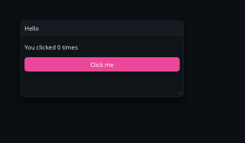 |
| `02_settings_form` | Text box with hint, combo, radios, switches, sliders, Save/Reset | 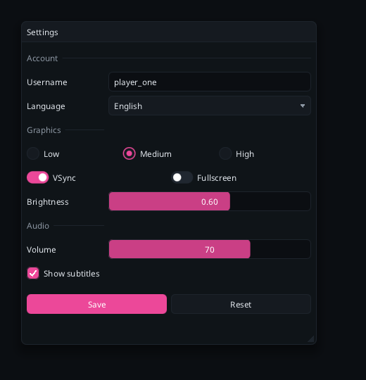 |
| `03_todo_list` | Text box + Enter to submit, `push_id` in a loop, tabs as a filter, icon buttons | 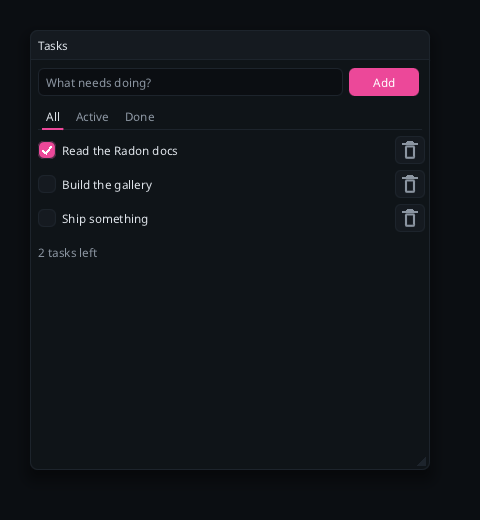 |
| `04_theme_editor` | Live theme editing, `Theme::with_accent`, color picker, presets | 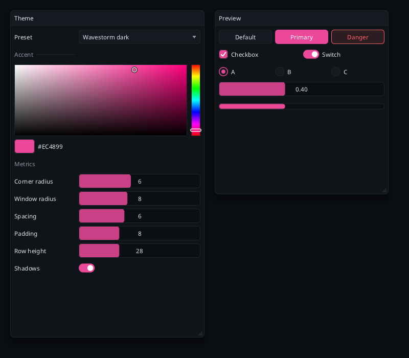 |
| `05_layout_cookbook` | Fixed/fill widths, equal columns, nested columns, child region, indent | 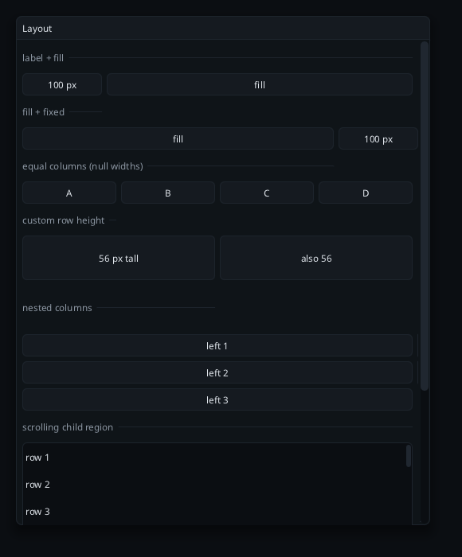 |
| `06_menus_and_dialogs` | Menu bar with checkmarks, popup, modal confirmation | 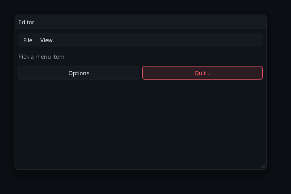 |
| `07_live_plots` | Rolling `plot_lines` and `plot_histogram`, stepper, switch, spinner | 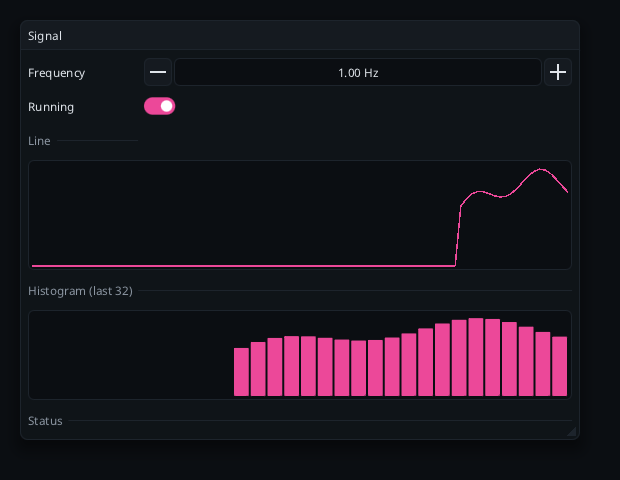 |
| `08_palette` | Swatches + `color_picker` editing a color in place | 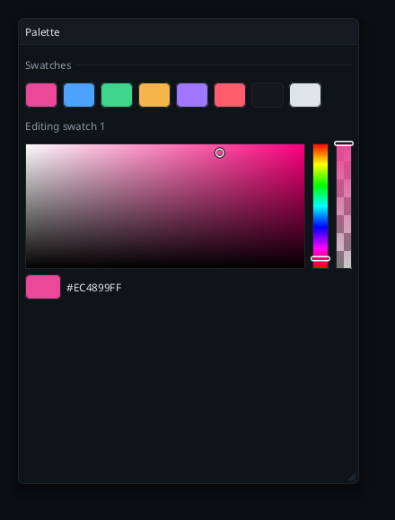 |
| `09_calculator` | A button grid with `layout_row` and primary-styled operators | 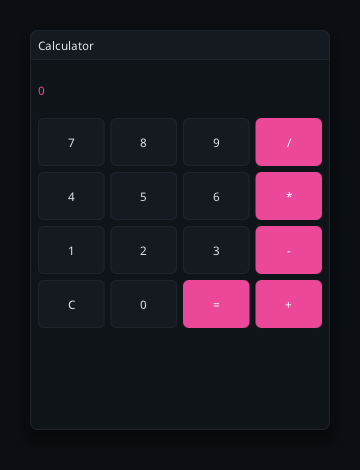 |
| `10_dashboard` | A docked creative-app layout: menu, toolbar, canvas, color/brush/layer panels | 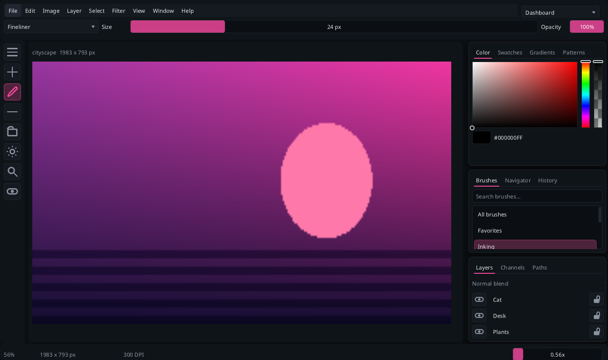 |

## The gallery

Six pages (`--page 0..5`): **Widgets**, **Inputs**, **Layout**, **Lists and menus**, **Theming**, and the
**Dashboard**. It adapts to narrow screens (below 760 logical pixels it swaps the sidebar for a combo box):

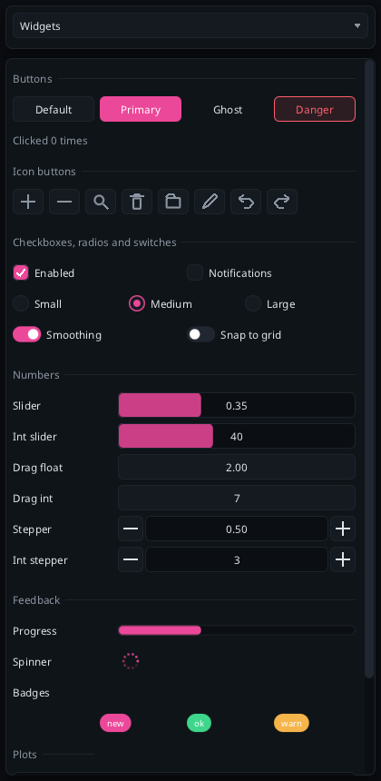 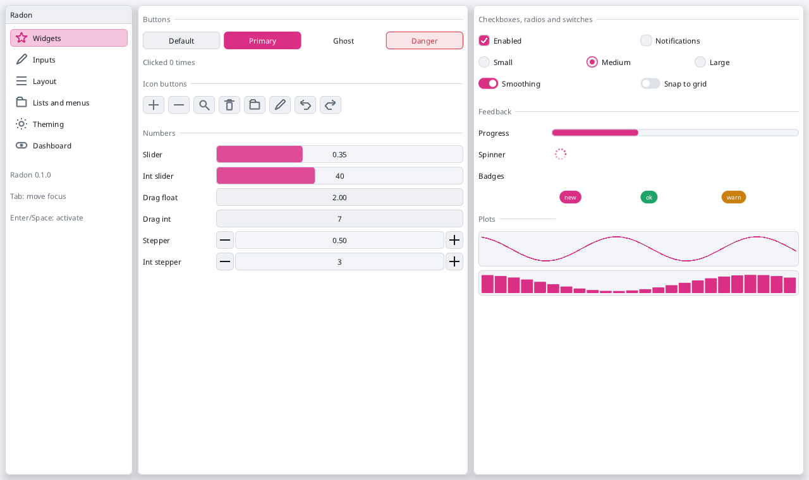

## Reading the examples

Each file is self-contained and commented where it teaches something:

- State lives in `static` variables next to the UI that edits it; Radon never owns it.
- `demo::run(argc, argv, cfg)` calls `cfg.frame(ctx, input, width, height)` between `begin_frame` and
  `end_frame`; the rest of the loop is the runner.
- To turn an example into your own app, copy its frame function and replace the runner with the loop from
  [getting-started.md](getting-started.md).

## Regenerating the screenshots

`scripts/screenshots.sh [build-dir]` re-renders every picture in `docs/screenshots/` (needs a window system
and a font).
