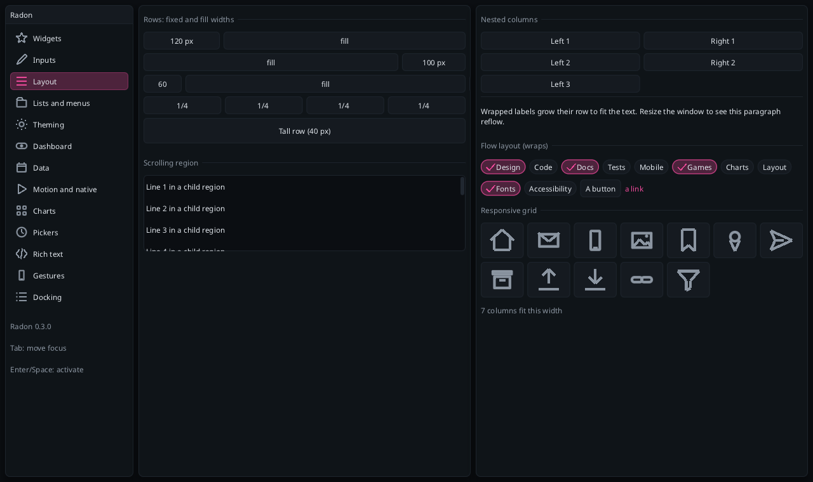
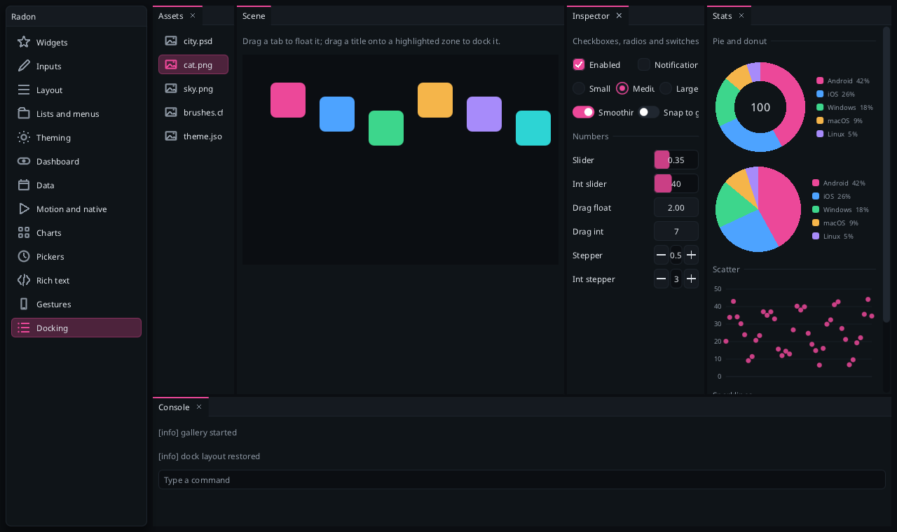

# Layout

Radon uses microui-style row layout. A **row** is a list of cells with widths and a height; every widget
call takes the next cell, wrapping to a new row when the current one is full.

```cpp
const float cols[] = {90, -1};
rd::layout_row(ui, 2, cols, 2, 0);     // 2 cells: 90 px, then fill the rest
rd::label(ui, "Volume");               // cell 1
rd::slider(ui, "##v", v, 0, 1);        // cell 2
rd::label(ui, "Pan");                  // wraps: cell 1 of a new row with the same widths
rd::slider(ui, "##p", pan, -1, 1);
```

## `layout_row(ctx, columns, widths, count, height)`

| Argument | Meaning |
|---|---|
| `columns` | Cells per row (max 16). |
| `widths` / `count` | Cell `i` uses `widths[min(i, count-1)]`. `nullptr` splits the row into equal cells. |
| width > 0 | Pixels. |
| width < 0 | Fill the remaining space. **-1 fills exactly**; -2 leaves 1 px; `{-100, 100}` is "fill, then 100 px". |
| `height` | `0` = theme `cell_height`; positive = pixels; negative = fill the remaining height (-1 exactly). |

Cells are separated by `theme.spacing`; windows pad their content by `theme.padding`.



## Columns

`layout_begin_column` / `layout_end_column` nest a vertical layout inside the next cell:

```cpp
const float halves[] = {-1, -1};
rd::layout_row(ui, 2, halves, 2, 0);
rd::layout_begin_column(ui);           // left cell becomes its own layout
  rd::layout_row(ui, 1, nullptr, 0, 0);
  rd::button(ui, "One"); rd::button(ui, "Two"); rd::button(ui, "Three");
rd::layout_end_column(ui);
rd::layout_begin_column(ui);
  rd::layout_row(ui, 1, nullptr, 0, 0);
  rd::button(ui, "Right");
rd::layout_end_column(ui);
```

The row below continues after the taller column.

## Other tools

| Call | Use |
|---|---|
| `spacing(ctx, px)` | Vertical gap; the next widget starts a fresh row. |
| `separator(ctx)` | A thin rule. `separator_text(ctx, "Group")` adds a caption. |
| `indent(ctx, px)` / `unindent(ctx, px)` | Shift the layout (default: `theme.indent`). `tree_node` does it for you. |
| `layout_next(ctx)` | The next cell as a `Rect`, for custom drawing or measuring. |
| `begin_child(ctx, id, height)` | A scrolling region that takes a full row; `-1` height fills the rest. |

## Flow and grid

```cpp
flow_begin(ctx);                       // sized widgets sit side by side and wrap
for (int i = 0; i < n; i++) chip(ctx, tags[i], on[i]);
button(ctx, "Add tag");
flow_end(ctx);                         // layout_row also ends it

int cols = layout_grid(ctx, 120, 90);  // as many >= 120 px columns as fit, 90 px rows
for (int i = 0; i < n; i++) image(ctx, thumbs[i], {120, 90});
```

Buttons, chips, badges, links, icon buttons and labels know their size; other widgets get `item_width`.

## Carousel and accordion

```cpp
if (carousel_begin(ctx, "cards", 150, 180)) {   // 150 px tall strip of 180 px items
    for (auto& c : cards) {
        layout_begin_column(ctx);                // one item, laid out vertically inside
        heading(ctx, c.title);
        layout_end_column(ctx);
    }
    carousel_end(ctx);                           // page dots; tap one to jump
}
for (int i = 0; i < 3; i++) {
    push_id(ctx, questions[i]);
    if (accordion_begin(ctx, questions[i], open, i)) {   // only section `open` is expanded
        label_wrapped(ctx, answers[i]);
        accordion_end(ctx);
    }
    pop_id(ctx);
}
```

A carousel scrolls by swiping, the wheel or its dots, and snaps to an item; a flick moves one further.

## Docking

```cpp
dock_space(ctx, "main", {0, menu_h, w, h - menu_h});   // outside any window, before the panels
if (begin_dock_panel(ctx, "Scene")) { /* ... */ end_dock_panel(ctx); }                 // the center
if (begin_dock_panel(ctx, "Assets", &assets_open, DockPlace::Left, 0.2f)) { /* ... */ end_dock_panel(ctx); }
if (begin_dock_panel(ctx, "Console", &console_open, DockPlace::Bottom)) { /* ... */ end_dock_panel(ctx); }
```

`DockPlace` and the ratio only apply the first time a panel appears: `Left`/`Right`/`Top`/`Bottom` add a
strip along that side of the whole dock, `Center` adds a tab to the central area, `Floating` starts as a
window. After that the user arranges things: drag the gaps to resize, click tabs to switch, drag a tab out
to float the panel, and drag a floating panel's title over a leaf to dock it (the middle of a leaf adds a
tab, its edges split it). With `open`, tabs and windows get a close button that sets it false. Empty
leaves fold away; the central area stays. Up to `Config::max_dock_nodes` nodes and `max_dock_panels`
panels. The layout lives in the context; it is not saved to disk.



## Wrapped text and images

`label_wrapped` and `image` grow their row to fit (up to 32 wrapped lines). `plot_lines` takes a height.

## Responsive layouts

Nothing is retained, so layouts are just code. The gallery switches from a sidebar to a combo box below 760
logical pixels wide, and splits pages into 1 to 3 window columns from the available width (see
`examples/common/gallery.cpp`).
