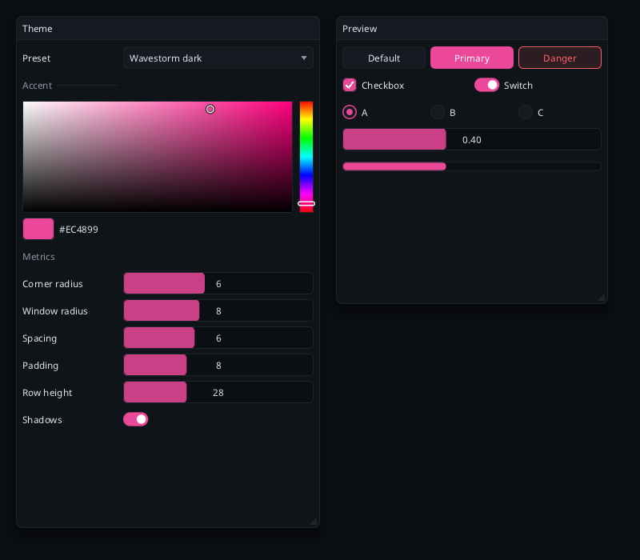

# Theming

Every color, size and spacing comes from one struct, `rd::Theme`. No widget hard-codes a value.



## Presets

```cpp
ui.set_theme(rd::Theme::dark());       // Wavestorm: near-black navy surfaces, hot pink accent
ui.set_theme(rd::Theme::light());
ui.set_theme(rd::Theme::midnight());   // the earlier neutral dark with a blue accent
```

`Theme::dark()` uses the palette of the Wavestorm Draw app: background `#0b0e12`, surfaces `#0f1418` and
`#151a20`, border `#1d242c`, accent `#ec4899`.

## Changing the accent

```cpp
rd::Theme t = rd::Theme::with_accent(rd::Theme::dark(), {61, 214, 140, 255});   // green
```

`with_accent` sets `accent`, `focus_ring` and the `selection` tint (the accent mixed into the surface).

## Fields

**Colors**: `background` (behind everything), `surface` (windows), `surface_hover` (controls at rest),
`surface_active` (pressed), `text`, `text_muted`, `accent`, `accent_text` (text on accent), `border`,
`shadow`, `error`, `success`, `warning`, `focus_ring`, `selection`.

**Metrics** (logical pixels): `padding`, `spacing`, `corner_radius` (controls), `window_radius`,
`border_width`, `scrollbar_width`, `title_height`, `cell_height`, `shadow_blur`, `focus_ring_width`,
`indent`, and `shadows` (bool).

**Fonts**: `font_body`, `font_heading`, `font_small`. A font handle already includes its pixel size, so
load the same file twice for two sizes:

```cpp
rd::Theme t = rd::Theme::dark();
t.font_body    = ui.load_font(data, size, 16);
t.font_heading = ui.load_font(data, size, 18);
t.font_small   = ui.load_font(data, size, 13);
ui.set_theme(t);
```

Fonts set to `-1` use the default font (the first one loaded).

## Scoped overrides

`push_theme` replaces the theme until `pop_theme` (8 levels). Use it to color one section:

```cpp
rd::push_theme(ui, rd::Theme::with_accent(ui.theme(), ui.theme().success));
rd::button(ui, "Confirm", rd::ButtonStyle::Primary);     // green
rd::pop_theme(ui);
```

Unbalanced pushes are undone at `end_frame` and set `ctx.error()`.

## Per-widget styling

- `ButtonStyle::{Default, Primary, Ghost, Danger}` on `button`.
- `label_colored(ctx, text, color)` and `badge(ctx, text, color)` take explicit colors.
- `color_button` and `color_picker` edit any color you own.

## Changing the theme at runtime

`set_theme` takes effect for the next widget call, so you can change it in the middle of a frame (the
theme editor example does). Animations are cosmetic: `Config::animations = false` disables hover and press
blending without changing any interaction result.

## Making your own

Start from a preset and change what you need; nothing else depends on the exact values:

```cpp
rd::Theme t = rd::Theme::dark();
t.corner_radius = 2;           // sharper controls
t.window_radius = 0;
t.shadows = false;
t.cell_height = 24;            // denser rows
t.padding = 6;
t.background = {16, 16, 20, 255};
```
