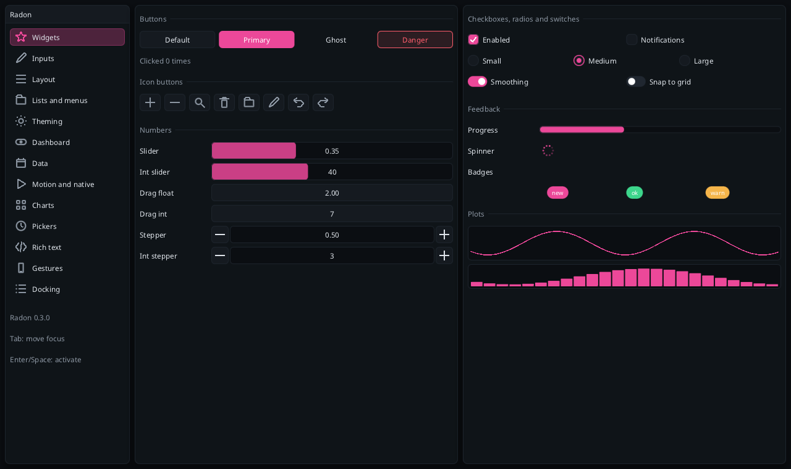
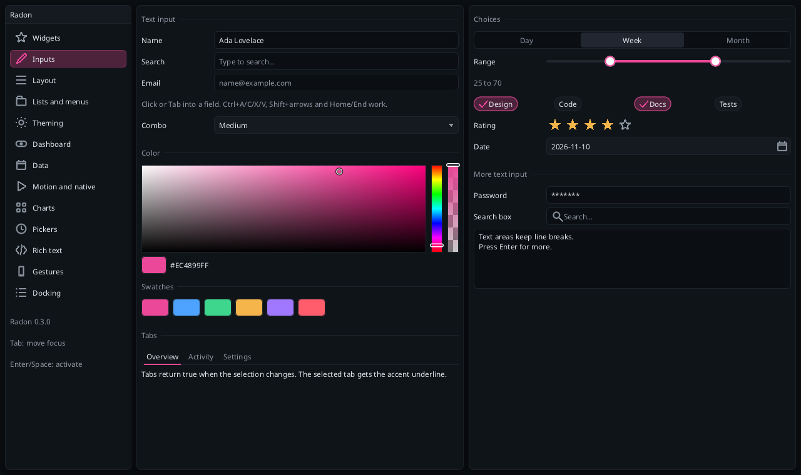
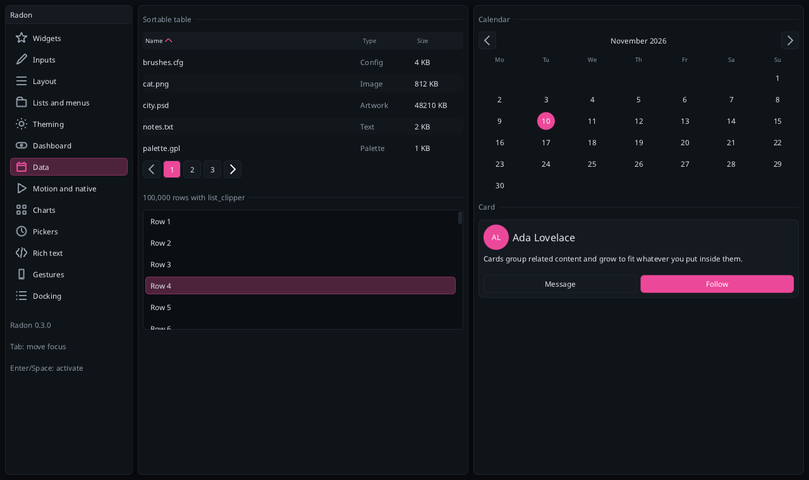
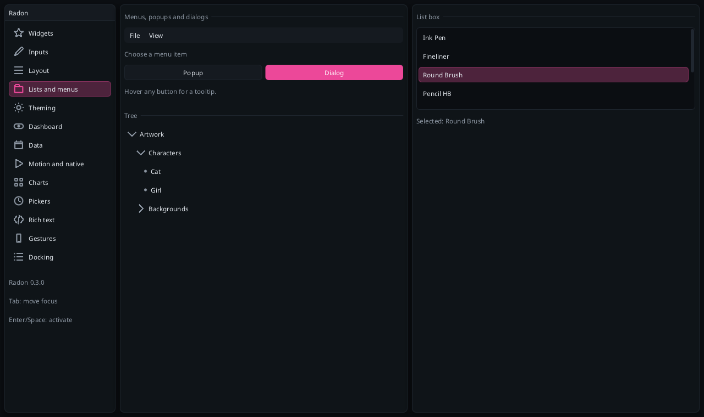
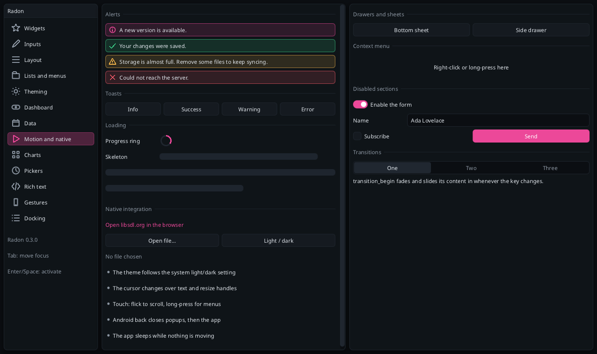
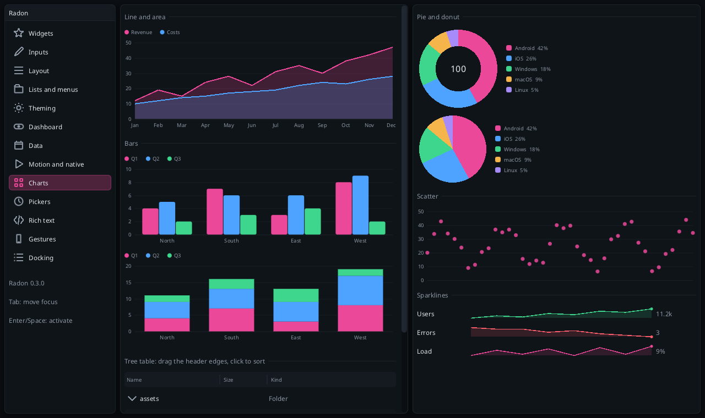
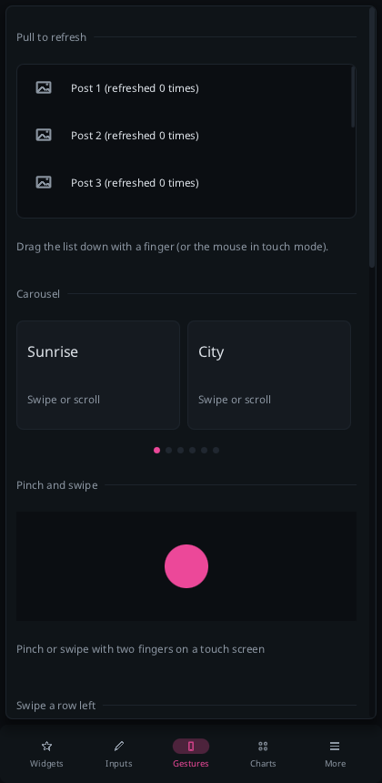

# Widget guide

Every widget takes the context first, uses the next layout cell, and returns a `rd::Response`
(`hovered`, `focused`, `pressed`, `clicked`, `changed`) or a `bool`. Labels are IDs; `"Text##id"` hides
the part after `##`. Snippets assume `using namespace rd;` and a layout row set up beforehand.



## Buttons

```cpp
if (button(ui, "Save").clicked) save();
button(ui, "Apply", ButtonStyle::Primary);   // accent fill
button(ui, "More", ButtonStyle::Ghost);      // no fill until hovered
button(ui, "Delete", ButtonStyle::Danger);   // error color
if (icon_button(ui, "trash", Icon::Trash).clicked) remove();
icon_button(ui, "tool", Icon::Pencil, tool == 1);       // highlighted while selected (toolbars)
```
Enter activates a focused button. `tooltip(ui, "text")` right after any widget shows a tooltip on hover.

## Toggles

```cpp
checkbox(ui, "Enabled", enabled);                 // bool&; Space toggles when focused
toggle(ui, "Dark mode", dark);                    // a switch with an animated knob
radio_button(ui, "Small", size, 0);               // int& shared by the group
radio_button(ui, "Large", size, 2);
```

## Numbers

```cpp
slider(ui, "##v", volume, 0.0f, 1.0f, "%.2f");   // printf format; Left/Right step 5% when focused
slider_int(ui, "##n", count, 0, 100);
drag_float(ui, "##d", speed, 0.05f);             // drag horizontally; 3rd arg = value per pixel
drag_int(ui, "##di", level, 0.25f);
stepper(ui, "##s", zoom, 0.25f, 0.25f, 4.0f);    // -  value  +  (drag the middle too)
stepper_int(ui, "##si", copies, 1, 1, 99);
```
All return `changed` when the value moved. Values are clamped to the range.

## Text input

```cpp
char name[64] = "";
TextBuffer buf{name, sizeof name, 0};            // non-owning; capacity includes the NUL
Response r = textbox(ui, "##name", buf, "Your name");   // optional placeholder
if (r.changed) onEdit();
if (r.clicked) onSubmit();                       // Enter
```
Click or Tab to focus. Supported: typing, Backspace/Delete, Left/Right (UTF-8 aware), Home/End, Shift to
select, Ctrl+A, Ctrl+C/X/V through the clipboard callbacks, mouse selection, caret blink, Escape to leave.
Text never overflows the buffer and never splits a UTF-8 sequence. Focusing a text box sets
`ctx.wants_text_input()`, which the SDL backend turns into the soft keyboard on mobile.

```cpp
password_box(ui, "##pw", buf, "Password");       // shows stars; copy and cut are disabled
search_box(ui, "##q", buf, "Search...");         // search icon + clear button; `changed` on clear too
text_area(ui, "##notes", buf, 96, "Notes");      // multi-line, 96 px tall; Enter adds a line
```
The text area scrolls with the wheel and the caret, and moves by line with Up/Down/Home/End and by page
with PageUp/PageDown. Lines break only at `\n` (there is no soft wrapping yet).

Every text box has **undo and redo** (Ctrl+Z, Ctrl+Y or Ctrl+Shift+Z; a run of typing is one step, the
history belongs to the focused box and holds `Config::undo_bytes`), **word-wise editing** (Ctrl+Left/Right,
Ctrl+Backspace/Delete, Ctrl+Home/End), **double-click** to select a word and **triple-click** for the line;
dragging after a double-click extends by whole words. On touch screens a **long press** selects a word and
shows a Cut / Copy / Paste / Select all bar, and two handles drag the ends of the selection.

```cpp
textbox(ui, "##age", buf, "Age", TextInputType::Number);   // asks for the number keyboard
textbox(ui, "##mail", buf, "Email", TextInputType::Email);
selectable_text(ui, "##log", log_text);                    // read-only, selectable and copyable
```

## Choosing

```cpp
combo(ui, "##c", selected, items, count);                    // true when changed; label is only the ID
tab_bar(ui, "##tabs", tab, tab_names, 3);                    // underlined tabs, one row
listbox(ui, "##l", sel, items, count, 150);                  // scrolling list in a 150 px region
list_item(ui, "Row", selected);                              // a selectable row (also with an Icon)
```

```cpp
segmented(ui, "##span", span, names, 3);                     // one track, sliding highlight
if (chip(ui, "Design", on).clicked) on = !on;                // a pill sized to its text
range_slider(ui, "##price", low, high, 0, 100);              // two thumbs; they never cross
rating(ui, "##stars", stars);                                // 0..5; click the current value to clear
date_picker(ui, "##date", year, month, day);                 // field + calendar popup
calendar(ui, "##cal", year, month, day);                     // the month grid on its own
pagination(ui, "##pages", page, page_count);                 // zero-based; ‹ 1 2 3 … 20 ›
int i = breadcrumbs(ui, "##path", parts, n);                 // clicked index or -1
if (link(ui, "Read the docs").clicked) open(url);            // accent text, hand cursor
```



## Color

```cpp
Color c{236, 72, 153, 255};
color_picker(ui, "##c", c, /*alpha=*/true);   // SV square + hue bar + alpha bar + hex readout
if (color_button(ui, "swatch", c).clicked) open_popup(ui, "pick");
```
The picker edits `c` while you drag; colors you set from outside are respected. It uses a 140 px row plus a
preview row.

## Display

```cpp
label(ui, "Plain");                          label_colored(ui, "Muted", t.text_muted);
label_wrapped(ui, long_text);                bullet_text(ui, "A point");
separator_text(ui, "Section");               progress_bar(ui, 0.4f);
badge(ui, "new", t.accent);                  spinner(ui);
plot_lines(ui, samples, n, 0, 1, 80);        plot_histogram(ui, samples, n, 0, 1, 60);
image(ui, texture_id, {96, 96});             // texture ids come from the backend
draw_icon(ui, Icon::Check, rect, color);     // any rect, e.g. from layout_next
```
Icons: Plus, Minus, Close, Check, ChevronDown/Up/Left/Right, Search, Eye, EyeOff, Lock, Unlock, Trash,
Folder, Menu, Dots, Settings, Star, Pencil, Undo, Redo, ArrowLeft/Right/Up/Down, Home, User, Bell, Heart,
Info, Warning, Calendar, Clock, Sun, Moon, Play, Pause, Refresh, Copy, Download, Share.

```cpp
heading(ui, "Title");                        // Theme::font_large
avatar(ui, "Ada Lovelace", t.accent);        // a circle with "AL"
alert(ui, Tone::Warning, "Storage is almost full.");   // Info, Success, Warning, Error; wraps
progress_ring(ui, 0.6f);                     skeleton(ui, 0.7f);    // loading placeholder
toast(ui, "Saved", Tone::Success);           // call once, not every frame; fades out after 3 s
```

## Tables and long lists

```cpp
static const char* const cols[] = {"Name", "Type", "Size"};
static const float widths[] = {-170, 80, -1};                // as in layout_row
if (table_header(ui, "files", cols, 3, widths, &sort_column, &ascending)) resort();
for (int i = 0; i < count; i++) {
    if (table_row(ui, i, selected == i).clicked) selected = i;   // stripe, hover, selection
    label(ui, rows[i].name);                                     // then one widget per column
    label(ui, rows[i].type);
    label(ui, rows[i].size);
}
```
Radon does not sort your data: the header only reports which column was clicked. Pass null for the last
two arguments for a header that cannot be clicked.

For thousands of rows, build only the visible ones:

```cpp
if (begin_child(ui, "log", 300)) {
    int first, last;
    list_clipper_begin(ui, 100000, 0, first, last);          // 0 = theme row height
    for (int i = first; i < last; i++) {
        layout_row(ui, 1, nullptr, 0, 0);
        list_item(ui, name_of(i), selected == i);
    }
    list_clipper_end(ui);
    end_child(ui);
}
```
Every row must have the same height. It works inside any scrolling window or child.



## Data tables

```cpp
static TableColumn cols[] = {{"Name", 160}, {"Size", 80}, {"Kind", 0}};   // width 0: fills the rest
static TableSort sort;
if (table_begin(ui, "files", cols, 3, 200, &sort)) {   // fixed header, 200 px scrolling body
    if (sort.changed) resort(sort.column, sort.ascending);
    table_tree_row(ui, 0, "assets", 0, &assets_open);  // indented first cell with an expand arrow
    label(ui, "");
    label(ui, "Folder");
    table_row(ui, 1);                                   // a plain row: one widget per column
    label(ui, "readme.md"); label(ui, "6 KB"); label(ui, "Text");
    table_end(ui);
}
```

Drag a header edge to resize a column (the width is written back to `cols`), click a header to sort.

## Containers

```cpp
if (collapsing_header(ui, "Advanced", open)) { /* ... */ }      // a header bar; returns the open state

if (tree_node(ui, "Artwork", open)) {                            // arrow row; indents children
    layout_row(ui, 1, nullptr, 0, 0);
    bullet_text(ui, "City");
    tree_pop(ui);                                                // only if tree_node returned true
}

if (begin_child(ui, "region", 120)) {                            // scrolling area, takes a full row
    /* widgets */
    end_child(ui);
}
```


if (begin_card(ui, "profile")) {                                 // bordered group, grows to fit
    /* widgets */
    end_card(ui);
}

const float cols[] = {sidebar_w, 8, -1};                         // a draggable divider
layout_row(ui, 3, cols, 3, -1);
/* left */  splitter(ui, "##split", sidebar_w, 120, 400);  /* right */
```
A card's height is its content height from the previous frame, so it settles one frame after its content
changes.



## Windows

```cpp
static Rect win{40, 40, 360, 300};
if (begin_window(ui, "Title", win, WindowDefault | WindowScrollable | WindowClosable)) {
    /* widgets */
    end_window(ui);
}
open_window(ui, "Title");        // reopen after the close button was used
```
`rect` is read and written: dragging the title bar or the bottom-right grip updates it. Flags:
`WindowMovable`, `WindowResizable`, `WindowClosable`, `WindowScrollable`, `WindowTitleBar`,
`WindowBorder`. A window without those is a plain panel; positioning panels yourself every frame gives you
fixed docked layouts like the gallery and the dashboard.

## Menus, popups and dialogs

```cpp
if (begin_menu_bar(ui)) {                          // a bar row at the top of a window
    if (begin_menu(ui, "File")) {
        if (menu_item(ui, "Open...", "Ctrl+O")) open();
        if (menu_item(ui, "Grid", nullptr, show_grid)) show_grid = !show_grid;   // checkmark
        end_menu(ui);
    }
    end_menu_bar(ui);
}

if (button(ui, "Options").clicked) open_popup(ui, "options");      // anchored under the last widget
if (popup_begin(ui, "options")) { /* widgets */ popup_end(ui); }   // closes on outside click / Escape

if (button(ui, "Quit").clicked) open_modal(ui, "quit");
if (modal_begin(ui, "quit", "Quit?", 320)) {                       // dims and blocks the UI behind it
    if (button(ui, "OK").clicked) close_modal(ui);
    modal_end(ui);
}
```
```cpp
button(ui, "Item");
if (context_menu_begin(ui, "item-menu")) {         // right-click or long-press on the last widget
    if (menu_item(ui, "Copy")) copy();
    popup_end(ui);
}

if (button(ui, "Share").clicked) open_modal(ui, "sheet");
if (drawer_begin(ui, "sheet", Side::Bottom, 260)) {   // Side::Left / Right for navigation drawers
    /* widgets */
    drawer_end(ui);
}
```
A drawer is a modal that slides in from a screen edge: it dims the UI, closes with `close_modal`, Escape,
the Android back button or a tap outside, scrolls when its content is taller, and keeps clear of the safe
area. Popups flip above their anchor and shift sideways to stay on screen.

One popup and one modal (or drawer) can be open at a time. `modal_begin` centers on `Input::screen_size`, so set that
field (the SDL backend runners do). `open_popup` / `open_modal` must run in the same ID scope as the matching
`_begin`.

## Disabled sections and transitions

```cpp
begin_disabled(ui, !logged_in);        // faded, ignores all input
/* widgets */
end_disabled(ui);

transition_begin(ui, "page", page);    // fades and slides in whenever `page` changes
/* the page */
transition_end(ui);

float w = animate(ui, "sidebar", open ? 240.0f : 56.0f, 0.2f, 56.0f);   // ease your own values
```
Popups, dialogs, drawers, toasts and tooltips fade in on their own; checkboxes, radios, switches, tab
underlines and segmented controls animate between states. `ui.set_animations(false)` turns it all off.



## Keyboard and touch

- **Tab / Shift+Tab** move focus through the focused window's widgets; a focus ring appears. **Enter**
  activates buttons, tabs, list rows and menu items; **Space** toggles checkboxes, switches and radios;
  **Left/Right** adjust sliders and steppers.
- **Touch**: a finger is the pointer. There is no hover; a tap within 8 px of the press is a click; dragging
  scrolls windows and child regions with momentum (but not sliders, which capture drags); holding still
  for half a second is a secondary click. Use `Theme::touch()` for finger-sized rows. More in
  [platforms.md](platforms.md).

## Pickers

```cpp
static const char* const sizes[] = {"S", "M", "L", "XL"};
wheel_picker(ui, "##size", size, sizes, 4, 5);          // iOS-style wheel: flick, it snaps; wheel/arrows too
time_picker(ui, "##alarm", hour, minute, /*h24=*/false); // a field that opens hour/minute/AM-PM wheels
combo_search(ui, "##country", country, countries, n);   // a combo with a filter box; Enter takes the first match
multi_combo(ui, "##tags", checked, tags, n);            // checkbox list; the field shows "A, B" or "3 selected"
autocomplete(ui, "##fruit", buf, fruits, n, "Fruit");   // suggestions while typing; Up/Down + Enter, or tap
number_pad(ui, "##pad", buf);                           // a 4x3 keypad that edits a TextBuffer
```

## Charts

```cpp
const float revenue[] = {12, 19, 15, 24}, costs[] = {10, 12, 14, 15};
const ChartSeries series[] = {{"Revenue", revenue, 4}, {"Costs", costs, 4}};
const char* const months[] = {"Jan", "Feb", "Mar", "Apr"};
chart(ui, "##sales", ChartType::Line, series, 2, months, 180);   // also Area, Bar, StackedBar, Scatter
pie_chart(ui, "##share", values, names, 5, 150, /*donut=*/true);
sparkline(ui, values, n);                                       // axis-free, for table cells and cards
```

Axes use "nice" steps (1, 2 or 5 times a power of ten) and short labels (`2.5k`, `1.2M`); x labels are
thinned to fit. Hovering (or touching) shows the values under the pointer. A series with alpha-0 `color`
takes the next `Theme::chart` color.



## Rich text and Markdown

```cpp
rich_text(ui, "**Bold**, *italic*, `code`, {#3dd68c}green{/}, :star: and [a link](https://example.com)");
RichTextResponse r = markdown(ui, "# Title\n\nA paragraph.\n\n- item\n1. step\n> quote\n```\ncode\n```");
if (!r.link.empty()) open_url(r.link);   // the URL of the clicked link, a view into your text
```

Text wraps at the cell width. `**bold**` uses `Theme::font_bold` (or draws the text twice when there is
none), `*italic*` uses `font_italic`, code uses `font_mono`. Icons are named after `Icon` (`:home:`,
`:heart:`, `:check:`, `:warning:`, ...). A backslash escapes the next character.

## Drag and drop

```cpp
list_item(ui, file.name, false);
drag_source(ui, "file", &file.id, sizeof file.id, file.name);   // after the widget it makes draggable
button(ui, "Trash");
if (const void* p = drop_target(ui, "file")) remove(*(const int*)p);
reorder_list(ui, "##steps", order, labels, n);                  // rows dragged into a new order
```

With a mouse a drag starts after 8 px; on touch after a long press, so a plain swipe still scrolls. The
payload (up to 256 bytes) is copied when the drag starts, the preview follows the pointer and targets of
the same type light up under it.

## Mobile patterns

```cpp
if (begin_window(ui, "feed", rect, WindowScrollable)) {
    if (pull_to_refresh(ui, "refresh", loading)) fetch();   // drag down past the top
    int act = -1;
    const SwipeAction actions[] = {{"Archive", Icon::Archive, ui.theme().warning},
                                   {"Delete", Icon::Trash, ui.theme().error}};
    swipe_item(ui, "Message 1", actions, 2, act);           // slides left to reveal the actions
    end_window(ui);
}
if (edge_swipe(ui, Side::Left)) open_modal(ui, "menu");     // swipe in from the screen edge
```

Bottom sheets and drawers follow the finger and close on a long or fast swipe toward their edge; bottom
sheets have a grab handle that also works with the mouse. Two-finger pinch, rotate and pan come from
`ctx.gesture()` and, while over them, `ViewportResponse::pinch`/`pan2` and `Canvas::pinch`/`pan2`.
Toggles, segmented controls, wheel pickers, long presses and drops ask for haptic feedback through
`ctx.haptic()`.



## Game views and canvas

`viewport(ctx, texture, size, flip_y)` shows an engine texture and returns the pointer and key input that belong to it; `canvas_begin` / `canvas_end` give a clipped 2D drawing area (`fill_rect`, `circle`, `line`, `sprite`, ...). See [game-integration.md](game-integration.md).

## Custom widgets

Build on `layout_next(ui)` to get a rect, then draw. The context exposes the draw list for the
backend only, so custom drawing goes through the widgets above (`draw_icon`, `image`, `plot_*`) or a
renderer-level hook in your own backend. If you need more primitives, add them to `DrawList`
(`rect`, `shadow`, `glyph`, `image`, `line`, `triangle`, `gradient_rect`) and call them from a widget in
`src/core/widgets/`; each is a few lines.
